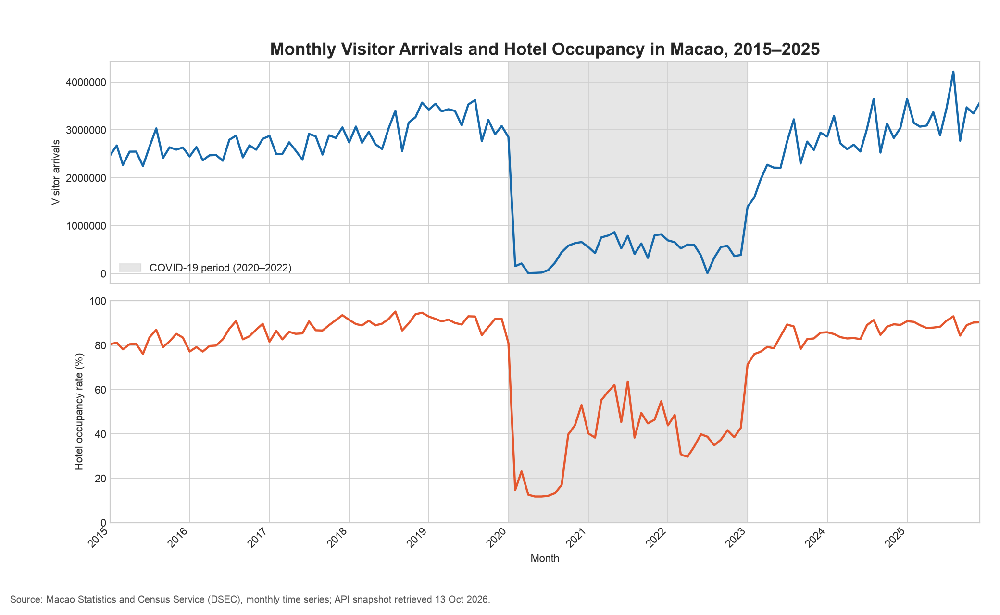
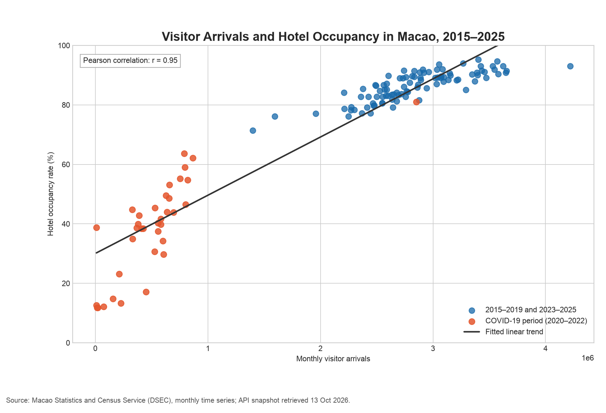

## About me

I am Ding Huiyuan, a student taking CISC7204 Data Science and Data Visualization. This portfolio presents my ongoing coursework project and the Python analysis used to explore a real research question.

## Technical skills demonstrated

- **Python and pandas:** reading CSV data, handling dates, aligning monthly observations, and validating data quality.
- **NumPy:** numerical analysis and a descriptive fitted line.
- **Matplotlib:** readable time-series, scatter, and comparison charts.
- **Data communication:** documenting sources, explaining findings, and distinguishing association from causation.

## Project showcase

### Visitor Arrivals and Hotel Occupancy in Macao

**Research question:** How did monthly visitor arrivals relate to hotel occupancy rates in Macao from January 2015 to December 2025?

**Status: Ongoing.** The reproducible descriptive analysis is available; seasonal, lagged, and room-supply analysis are future work.

**Data:** 132 matched months of public aggregate statistics from the Macao Statistics and Census Service (DSEC). The complete official snapshot was retrieved on 13 October 2026.

### Main finding

Months with more visitor arrivals generally had higher hotel occupancy. Across all 132 months, **Pearson r = 0.947**. Both indicators declined during 2020–2022 and recovered afterwards.

*Figure 1. The shared time axis shows the timing of the disruption and recovery; separate panels keep arrivals and percentages in their own units. Source: DSEC.*

*Figure 2. Each point represents one month. The line summarizes a positive association; it does not establish that more visitors caused higher occupancy. Source: DSEC.*

### Why the period matters

The association varies by period: r = **0.808** for 2015–2019, **0.770** for 2020–2022, and **0.913** for 2023–2025. Looking at these periods helps interpret the full-sample value.

*Figure 3. All three subperiods show positive association, but different strengths. These are descriptive correlations, not significance tests. Source: DSEC.*

### Limitation and next improvement

**Correlation does not prove causation.** Seasonality, common trends, travel restrictions, changes in hotel-room supply, and serial dependence may influence the results. Total arrivals include same-day visitors who may not use hotels. I plan to examine overnight arrivals, room supply, and seasonal or lagged relationships next.

### Explore the work

[Open the project repository](https://github.com/DingHuiyuan-MC635708/data-science-project) · [Read the analysis and reproduction instructions](https://github.com/DingHuiyuan-MC635708/data-science-project#reproduce-the-analysis) · [View the original coursework](https://github.com/DingHuiyuan-MC635708/CISC7204-MC635708-2026GitHub/tree/main/cisc7204-Assgn01-2026-MC635708/proposal)

## Attribution and responsible use

The original CISC7204 Assignment 01 proposal is a pair project by **Ding Huiyuan and Duan Qingru**. Its proposed roles assign me coordination and data preparation, and my partner source verification and visualization review. This portfolio acknowledges that shared origin and presents an extended, reproducible version with documented AI assistance; it does not claim sole authorship of the original work.

The data source is [DSEC's Time Series Database](https://www.dsec.gov.mo/ts/), indicators 14023 and 13005. [DSEC's Tourism Statistics publication](https://www.dsec.gov.mo/getAttachment/499c7a1c-4b70-439e-a650-268f33dc0d27/E_TUR_FR_2025_Q4.aspx) permits reproduction of the statistical data when the source is quoted. No personal visitor or hotel records are published. Historical values can be revised; this analysis consistently uses its retained official snapshot.

[AI assistance record](https://github.com/DingHuiyuan-MC635708/data-science-project/blob/main/AI_USAGE.md)
